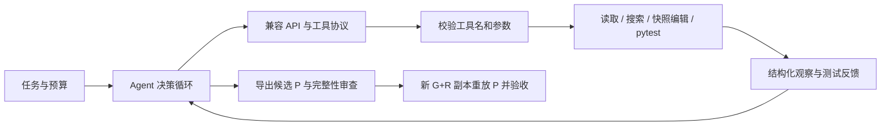

# MVP 0.2 工程现状（2026-10-29）

## 目标与当前结论

本项目研究一个可解释、可检查的仓库修复 Agent：模型根据代码和工具反馈决策，在指定 Git 工作副本内编辑业务代码，依据 pytest 反馈继续修复，并由独立流程验收保存的补丁。

目前已实现真实模型接入、仓库工具、快照编辑、测试反馈、固定 G/R/P 实验编排、运行证据与独立补丁验收。本机已有 browser-use #5998 和 pydantic-ai #10525 两项已知答案实验的独立通过记录。Docker 沙箱、广泛评测和跨机器环境复建尚未完成。

本页根据现有实现及保存的报告整理。代码和文档可上传 GitHub；完整 `runs/`、`experiments/`、本机环境和密钥不在上传范围内。文档中的历史结果不是本次重新运行所得，也不代表完整实验材料已公开。

2026-10-29 本机在 Python 3.13.13 下执行 `python -m unittest discover -s tests -v`，141 项离线自检全部通过，退出码为 0。这是本机自检，不是 GitHub CI，也不代替目标仓库的真实缺陷复现。元数据与完整输出保存在被忽略的 `runs/engineering/20261029-154055/`，未随文档上传。

## 系统如何工作



模型通过 Chat Completions 原生 `tool_calls` 选择工具，程序定义参数 Schema、构造 `Decision` 并序列化反馈。普通回复中的 JSON 不作为可执行决策。未知工具、无效参数及不支持的调用组合被拒绝，反馈仍受原步数预算约束。

`read_file` 保存原始内容及 SHA256，返回 `snapshot_id` 和展示范围。`replace_lines` 只接受对应快照中的行，编辑前检查整文件版本，再生成 unified diff，经 `git apply --check` 后应用。文件发生变化或编辑成功后须重新读取，避免使用过期快照覆盖其他改动。

测试工具执行固定形式的 `python -m pytest`，将退出码及输出反馈给模型；失败时模型可继续观察、修改和测试，直到完成、中断、出错或达到预算。模型的 `finish` 仅表示停止决策；候选是否有效由导出审查和独立验收决定。

### 模块职责

| 模块 | 职责 |
| --- | --- |
| `agent.py` | observe–decide–act 循环、消息反馈、预算、终止状态与 JSONL 轨迹 |
| `provider.py`、`config.py` | 兼容 API 请求、配置读取、传输错误分类和有限重试 |
| `decisions.py`、`prompts.py` | 工具声明、参数校验和任务执行约束 |
| `tools.py`、`workspace.py` | 仓库读查、快照编辑、定向测试和 detached worktree |
| `experiments.py` | 固定 G、恢复 R、导入来源检查、缺陷复现和基线认领 |
| `experiment_runner.py` | 准备、Agent、导出、独立验收的完整编排与总报告 |
| `experiment_artifacts.py` | 单独导出 P，检查允许路径、文件清单、HEAD、index 与编辑轨迹 |
| `experiment_verify.py` | 新工作副本复现 G+R，应用保存的 P，运行预定目标并核验完整性 |
| `run_evidence.py` | 允许范围内的 Agent 磁盘源码归档、运行环境元数据和源码漂移检查 |
| `round_layout.py`、`path_migrations.py` | 统一轮次命名、摘要、索引与历史路径解析 |

以上模块位于 `repo_agent/`。两个 Issue 的任务和固定实验配置由各自的 `examples/` 入口提供，不通过修改另一个入口的全局变量复用流程。

## 模型配置与重试边界

Provider 使用标准库 HTTP 客户端连接 OpenAI-compatible 服务，不要求特定模型 SDK。配置优先级为显式参数、进程环境变量、项目 `.env`。

`LLM_PROFILE=gpt` 或 `qwen` 分别选择 `GPT_*` 或 `QWEN_*` 配置；这些名称是分组标签，具体模型由对应 `MODEL` 字段决定。选中分组后不借用另一组的 URL、密钥或模型。未选 profile 时保留 `LLM_*` 等兼容读取方式。[配置模板](../.env.example) 不包含可用密钥。

部分 TLS EOF、请求超时、连接重置或读取中断可重试，最多两次额外请求，默认间隔为 0.5 秒和 1 秒。重试针对同一次模型请求，不重新执行本地工具。HTTP 错误（包括 429）、证书验证失败、响应 JSON 或工具协议错误不走此传输重试；协议错误按既有决策反馈处理。系统不会通过关闭证书校验、更换模型或无限重试掩盖失败。

## 实验协议与记录

一次实验把三个对象分开：

- **G**：准确的上游历史 commit。
- **R**：准备阶段冻结的回归测试补丁，保留权威文件与 SHA256，Agent 不得修改验收规则。
- **P**：Agent 对允许业务文件的最终修改，单独导出，不混入 R。

准备阶段先检查解释器、导入源码和工作副本，证明目标测试因指定缺陷失败、控制测试通过。环境或导入错误不算 Bug 复现。Agent 运行结束后，即使其状态为 error 或 step limit，也保留候选和失败原因；符合导出资格的 P 才能进入独立验收。

独立验收在新的 G+R 副本中再次复现缺陷，应用已保存的 P，运行预定回归与控制测试，并检查文件、HEAD、index、保护路径和环境版本元数据。不会从后来可能改变的旧副本重新生成 P，也不会只凭模型声明、测试被跳过或原副本最后一次通过宣布成功。

轮次 ID 使用北京时间 `YYYYMMDD-HHMMSS_<8位ID>`，内部 UTC 时间字段保留。正式运行一次分配 ID，各阶段共享；名称不随结果改变：

```text
runs/<experiment>/run_<ID>/
  round.json
  summary.md
  experiment.json
  repair/
  verify-01/
experiments/<project>/workspaces/
  <issue>_<ID>_agent/
  <issue>_<ID>_verify-01/
```

单独准备根名为 `prepare_<ID>`；后续使用 `--manifest` 运行模型仍保留最初入口类型。重复验收追加 `verify-02` 等及新工作副本，不覆盖旧报告或改写原总报告的历史成功事实。中文摘要和各 Issue 的本机 `INDEX.md` 用于导航，原始证据才是结论依据。

### 源码与测试证据

新实验入口在模型启动前归档 `repo_agent/*.py` 及两个实验入口的允许范围磁盘源码，保存文件哈希、相关 Git HEAD/未提交状态及解释器信息；结束后另存漂移检查。它不证明已加载的 Python 代码对象与磁盘快照完全等价，也不能只用 Git HEAD 代替未提交源码的版本证据。

Agent 的测试调用保存完整 stdout/stderr 和元数据，模型仅接收有长度限制的尾部及日志引用；完整输出和模型看到的反馈不是同一层证据。超时、日志写入失败和未运行测试不会伪装为测试通过。早期 browser-use 成功轮没有这些后来新增的源码归档，历史记录未被补造或回填。

### Windows 与历史材料完整性

Git 工作副本、diff、apply 等相关操作使用每命令 `core.longpaths=true`，不修改全局 Git 或系统策略。文件清单对 Windows 超长路径使用扩展 IO 路径读取，保留原相对 key，避免把实际存在的保护文件误记为缺失。Git 准备失败或超时会在新轮保存命令、退出码/超时标志及完整输出；旧轮从未保存的输出无法事后恢复。

已有材料按项目输入和轮次角色整理，通过 `experiments/path-migrations.json` 解析旧路径及迁移链。映射限制在项目的 `experiments/` 与 `runs/` 区域，拒绝根映射、越界、歧义和循环，解析后仍检查符号链接来源。原始 JSON 内的历史 ID、路径、日志和补丁保持原字节。

2026-10-29 轮次整理时，358 个原历史文件经映射逐一核对，内容未变；17 个 linked worktree 与两份 source 共 19 个 checkout 的 HEAD、状态、diff、index 和文件库存保持一致，三套环境的版本列表一致。此数字对应当次迁移的冻结范围，不是当前全部实验文件数。没有关联证据的副本标为 `legacy-unlinked`，没有为失败轮补造工作副本。详细规则见[目录说明](experiment-layout.md)。

## 两项已知答案实验

以下为本机报告核实结果，未在整理文档时启动新的模型或目标测试。两项均有公开参考修复，作为已知答案实验检验 Agent 和实验流程，不宣称参考修复已合入上游或由本项目贡献。

| 项目 | browser-use #5998 | pydantic-ai #10525 |
| --- | --- | --- |
| 官方仓库 | [browser-use/browser-use](https://github.com/browser-use/browser-use) | [pydantic/pydantic-ai](https://github.com/pydantic/pydantic-ai) |
| Issue | [#5998](https://github.com/browser-use/browser-use/issues/5998) | [#10525](https://github.com/pydantic/pydantic-ai/issues/10525) |
| G | `7be96ed8bafa8dfe1eef228b59cf5c884b8b2431` | `b4b9ad3de2d7a9cbfd7c70715f1f945496e990ce` |
| 代表轮 ID | `20261026-175230_22903996` | `20261029-152335_25271a9c` |
| 模型记录 / profile | `gpt-6-luna` / `gpt` | `gpt-6-luna` / `gpt` |
| Agent 状态 | `agent_reported_finished` | `agent_reported_finished` |
| 决策步数 / 工具动作 | 13 / 12 | 12 / 11 |
| P 导出 | `candidate_exported`，具有验收资格 | `candidate_exported`，具有验收资格 |
| G+R 准备 | 目标失败、1 项控制通过 | 优化模式目标失败、4 项控制通过 |
| 独立 G+R 复现 | 同样目标失败、控制通过 | 同样目标失败、4 项控制通过 |
| 独立 G+R+P | 2 项均通过，无错误或跳过 | 5 项均通过，无错误或跳过 |
| 验收报告状态 | `independently_verified` | `independently_verified` |
| 目标 Python | 3.11.16 | 3.13.13 |
| Agent 源码归档 | 此旧轮未记录 | `captured`，结束检查 `unchanged` |

两个代表轮的 pytest 元数据版本均为 9.1.1、pydantic 为 2.13.5，独立验收报告的解释器及包版本比较均通过。这只是版本元数据一致，不证明全部依赖二进制和外部环境等价。

### browser-use #5998

问题是注册 action 的 keyword-only 参数调用被当作位置参数处理。允许编辑的业务文件仅为 `browser_use/tools/registry/service.py`。两个固定目标位于 `tests/ci/infrastructure/test_registry_core.py::TestActionRegistryParameterPatterns`：

- `test_keyword_only_parameters_no_browser`：G+R 退出码 1，失败数 1；独立应用 P 后退出码 0，通过数 1。
- `test_individual_parameters_no_browser`：修前、修后退出码均为 0，通过数均为 1。

R 的权威文件为 [regression.patch](../examples/fixtures/browser_use_5998/regression.patch)，SHA256：

```text
3739b170ece5bc66da973846898e492115c0f45e24b46d851b8a2b37a8fc176e
```

代表轮保存的业务 P SHA256：

```text
7eb9205ee06dba75846e895b5d2abceffa136a60955b30504214438c436b229b
```

### pydantic-ai #10525

问题是 `python -O` 删除 bare assert 后，非对象 JSON 参数可能逃出字典契约。允许编辑的业务文件仅为 `pydantic_ai_slim/pydantic_ai/messages.py`。固定目标均位于 `tests/test_messages.py`：

- `test_issue_10525_non_object_json_optimized`：G+R 退出码 1、失败数 1，独立应用 P 后通过。
- `test_issue_10525_non_object_json_normal`：普通模式控制通过。
- `test_args_as_dict_valid_json`：合法 JSON 控制通过。
- `test_args_as_dict_non_dict_json_returns_invalid_json_wrapper`：默认包装行为控制通过。
- `test_args_as_dict_raise_if_invalid_non_dict_json`：严格异常契约控制通过。

独立应用 P 后五项均退出码 0，各通过 1 项，无错误或跳过。外层 pytest 正常运行；冻结 R 在子进程内分别检查 normal/`-O`，使用显式失败逻辑及源码来源检查，不依赖会被优化删除的 assert。

R 的权威文件为 [regression.patch](../examples/fixtures/pydantic_ai_10525/regression.patch)，SHA256：

```text
4365ee7b3842d66dda5743dcae4d2e71282f5132455561a730be69c58ab28a20
```

代表轮保存的业务 P SHA256：

```text
da5d7adfc29344fe4de02c8a68606ad1c91dbd47573a0728863dc4e9a258c72a
```

本机此前的 `20261029-144226_7c920922` 轮也有独立通过记录。两轮记录不构成成功率估计或模型稳定重复性的验证；没有预先定义抽样方案、分母和重复实验矩阵。

## 本次记录的公开范围

本次整理 README、协作规则和本页工程现状，不复制业务 P、完整 trace、Agent 源码快照、所有原始日志或环境到公开目录。上面的 P 哈希用于与本机原件对照，不表示 GitHub 已提供该补丁文件或可直接复建整个实验。

权威 R 与代码一起受版本管理；完整本机材料仍按 `runs/<experiment>/run_<ID>/` 保存并被忽略。新克隆可以检查代码、阅读协议和运行离线示例；真实实验需要另行准备历史源码与目标依赖。保存 P 的独立重放与重新调用模型是两件事；本次没有新增跨机器复验，也没有提交或推送操作，上传由仓库维护者完成。

## 待完成与下一阶段

- **执行隔离**：Docker 沙箱、资源和网络边界；当前 worktree 不提供这些能力。
- **效率记录**：测量 API 请求数、上下文长度、反馈体积、时间与费用，再比较压缩或检索改进；目前不宣称已经降本。
- **评测范围**：增加缺陷类别、失败案例与重复运行，记录完整分母，分开报告候选产出、独立补丁通过和模型重复运行结果。
- **环境复建**：依赖锁与安装步骤、跨机器重放、平台差异检查，减少依赖本机已有环境的部分。
- **代码理解**：更精确的符号检索和上下文管理；保持编辑版本检查和验收边界。

运行方式见 [README](../README.md)、[browser-use 实验手册](experiment-01-runbook.md)和 [pydantic-ai 实验手册](experiment-02-runbook.md)。核心协作和证据约定见 [AGENTS.md](../AGENTS.md)。
