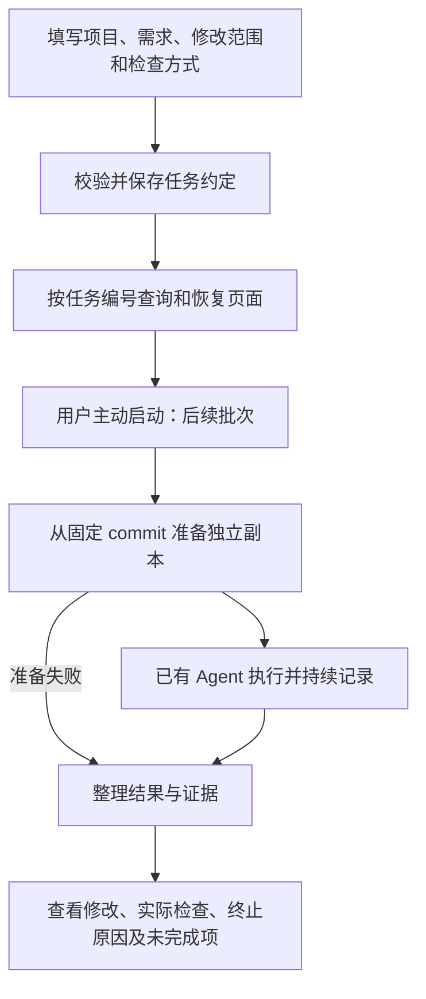

# V0.3 开发计划与模块分工

2026-11-02 更新：[统一数据模型](data-model.md)规定项目→需求任务→多轮运行→独立验收，物理目录复用[已有实验布局](../experiment-layout.md)。**首批只读历史已接入4176**：两实验项目的需求、轮次及准备/Agent/补丁导出/验收报告可读取，见[接口](history-api.md)与[实际交付](history-verification.md)。写入仍未统一：普通任务仍写 runs/tasks，既有实验由 Spec/Runner 写 runs/<task-key>；没有迁移材料或实现网页新实验启动。原 M1/M2a/M3 文档保留为历史交付，不作为继续另建任务存储体系的目标方案。

M2a 增量：独立工作副本准备的接口与并发规则见 [准备契约](preparation-api.md)，运行见 [M2a 后端说明](m2a-runbook.md)。下文 M1 范围描述保留为该批次记录；M2a 不包含任务执行。

原交付日期：2026-10-31。M1 保存查询、M2a 副本准备及 M3 普通修复任务 Agent 接入已实现。M3 契约见 [执行接口](execution-api.md)，启动见 [运行说明](m3-runbook.md)，当时交付证据与限制见 [M3 验收](m3-verification.md)。随后用户已完成一次真实 Provider 普通任务（`785d4df18fb74b3db558cb17fb63c026`），其固定最终检查/范围审查通过；这不代表网页实验独立验收或统一数据模型已实现。V0.3 全版尚未完成。下文保留初始计划及 M1 批次范围。

## 1. 本版要解决的问题

现有 Agent 能在指定工作副本中读取、修改、测试代码；现有前端能展示三页演示，但没有连接任务后端。V0.3 要让用户从网页提交普通任务，查看执行过程和最终材料。网页与命令行共用任务流程，避免出现两套修复逻辑。

按先贯通一个修复任务，再扩展阅读代码、补充小功能的顺序推进。前端样式由前端会话负责，核心流程与记录含义由主会话和用户共同确定。

## 2. 当前事实与设计边界（2026-11-02 更新）

| 项目 | 当前事实 |
| --- | --- |
| Agent | 已有模型决策、工具操作、步数预算、JSONL 轨迹 |
| 工作副本 | 已有 `workspace.create_worktree`，不提供执行沙箱 |
| 通用命令行 | 现有 `repo_agent.__main__` 直接构造 Agent，不是完整任务服务 |
| 实验入口 | 已有固定 G/R/P 编排及独立验收，继续保留 |
| 前端 | 已接普通任务保存、准备、启动、事件/结果及真实任务列表；另保留演示路由，尚无两实验项目的历史轮次页 |
| 普通任务持久化 | runs/tasks 下保存不可变任务约定及单次准备/执行；最近50条列表可找回，不是目标中的需求下多轮运行模型 |
| 本地 HTTP | 支持普通任务主动启动既有 Agent；尚未适配实验历史与 Spec/Runner 网页启动 |

后续统一组织以 [数据模型设计](data-model.md)为准；既有普通任务输入输出仍见[接口契约](task-api.md)。任务保存、模型执行、实际检查和独立验收分别记录，不能从其中一项成功推导其余结论。

## 3. 完整使用流程



任务创建只保存约定，不授权自动调用模型。真实模型启动仍由用户主动执行。演示数据与真实记录分开；真实记录进入历史列表后，记录性质不变。

## 4. 当前批次：M1 保存与查询

用户填写需求、保存成功后取得随机编号；刷新页面或重启服务后，可以按编号恢复同一份任务。保存后的约定固定，改需求新建任务。

本批次包含：

- 本地项目配置及只读项目列表，让网页获得真实的项目编号，不使用演示名称代替。
- 创建、查询任务，校验字段并解析准确起始 commit。
- JSON 文件持久化，区分任务不存在、记录损坏和存储故障。
- 前端保存、详情恢复，以及加载、错误和结果不确定的展示。

本批次不包含副本创建、Agent 启动、任务执行状态订阅、历史列表、最终 diff/测试报告接口、数据库或历史材料迁移。执行页与结果页仍保留明确的演示标识，不能把保存成功展示成启动成功。

## 5. 模块分工

M1 已按以下文件职责实现。当前通用 CLI 保持原功能，未来普通任务 CLI 调用任务服务；本轮尚未新增这类 CLI。

| 位置 | 职责 | 不应承担的工作 |
| --- | --- | --- |
| `frontend/app.js` | 表单转换、调用接口、地址中的编号、加载/错误/详情展示 | 不生成权威任务编号，不自行决定保存成功 |
| `repo_agent/task_http.py` | 路由、JSON 请求响应、HTTP 状态码、本地服务和前端资源入口 | 不编排模型修复，不接收任意文件下载路径 |
| `repo_agent/task_service.py` | 创建/查询用例，调用项目配置、版本解析、存储 | 不依赖 HTTP 对象，供未来 CLI 复用 |
| `repo_agent/task_contract.py` | 字段、默认值、数据校验、错误结构 | 不访问磁盘或调用模型 |
| `repo_agent/task_store.py` | 新任务独占目录、JSON 写入、读取和记录完整性检查 | 不判断业务修复是否成功 |
| `repo_agent/task_projects.py` | 本机项目配置、公开项目列表、解析起始 commit | 不向网页返回本机绝对路径、环境或密钥 |
| 现有 Agent/Provider/RepoTools | 后续任务执行批次复用 | M1 不启动、不修改实验验收规则 |

工作分配：主会话先解释并与用户评审后端契约，后端实现按上述顺序分批推进；前端会话负责接口适配及页面行为。先提供接口文档，再交接实现，不以聊天片段作为唯一约定。

前端现在的 `project`、`scope`、`targets` 是演示表单字段；适配时分别映射到 `projectId`、`allowedPaths`、`checkTargets`，逐行拆分路径和目标。项目编号必须来自项目接口。

## 6. 本地文件组织

```text
runs/tasks/
  projects.json                 本机配置，不进入公开示例
  task_<32位随机十六进制ID>/
    task.json                   本轮保存的权威任务记录
```

沿用 `runs/` 被忽略的约定，不把它表述为远端备份。项目配置包含项目编号、展示名称、仓库位置；服务端负责读取。文档与演示中不复制真实绝对路径、密钥或历史完整记录。

任务编号使用完整随机 ID，不采用递增编号或前端传入的目录名。编号不等于访问权限；首版本地服务仅监听回环地址，不开放跨域写入。更广泛访问另立需求。

创建记录先在新建的任务目录写入临时文件，完成后原子替换为正式 JSON，成功后再响应。随机 ID 碰撞时重试，禁止覆盖既有任务。临时文件不作为已保存任务读取；写入失败保留失败材料，不自动删除历史成果。具体 IO 失败与中途退出处理需由存储测试验证，不承诺断电级持久性。

## 7. 开发与验收顺序

| 批次 | 工程交付物 | 完成依据 |
| --- | --- | --- |
| 当前：设计 | 本计划、接口契约、验收用例、未决项 | 用户能理解流程，文档评审后作为实现依据 |
| M1a | 契约、项目配置、任务服务及文件存储 | 离线用例覆盖校验、版本固定、写入/读取及失败场景 |
| M1b | HTTP 接口及本地运行说明 | 用 HTTP 请求验证成功与错误响应，重启服务后仍可读取 |
| M1c | 前端保存与按编号恢复 | 浏览器提交、刷新恢复；失败不显示成功；启动仍禁用 |
| M1 收尾 | 变更记录、验收结果、已知限制 | 每项结论对应实际命令或页面检查，不用演示代替联调 |
| 后续 M2 | 副本准备、统一启动与过程记录 | 另行设计评审；真实模型仍由用户运行 |
| 后续 | 结果交付、三类任务、回归与版本报告 | 沿用用户确定的 V0.3 总顺序，逐批确定范围 |

实施前说明本批问题与方案，完成后解释改动和证据；不跨批自动启动真实实验。现有 #5998/#10525 的测试、报告、G/R/P 材料不改写，普通任务测试通过不推导为独立实验验收通过。

## 8. M1 验收清单（计划，实际结果见验收记录）

- [x] 有效需求保存为新任务，返回随机编号，准确 commit 与请求引用对应。
- [x] 按编号查询得到相同约定，保存后源分支移动不改变已存 commit。
- [x] 页面刷新和服务重启后可恢复；刷新经浏览器验证，服务重建经 HTTP 集成验证。
- [x] 必填缺失、未知字段、类型错误、非法路径、测试权限冲突被拒绝。
- [x] 不存在编号、损坏记录、写入故障返回不同错误；失败不报告成功。
- [x] 新任务不覆盖旧任务；残留临时文件不被当作有效记录。
- [x] M1 响应不包含仓库绝对路径或密钥；恶意编号与链接记录被拒绝。
- [x] 连续点击保存不会并发发送；响应丢失时提示结果未知，不自动重发 POST（前端模拟验证）。
- [x] M1 页面无虚假运行状态，M1 专项验收不创建工作副本、不请求真实模型；既有回归另在临时合成仓库创建验收副本。

## 9. 设计评审要点

M1 服务同时提供前端与 API，避免两端口跨域配置；不增加独立数据库、队列或自动重试。实现采用标准库 HTTP 服务：当前只有本地单用户的三项 API 和固定静态资源，无需额外依赖。启动命令为 `python -m repo_agent.task_http --port 4173`，具体用法见[运行说明](runbook.md)。该选择仅覆盖本机首版，非多用户部署方案。

还未设计：任务启动的重入控制、取消、存活检测、最终检查执行、允许修改路径的执行约束。这些是后续必做项，不因本轮接收并保存字段而视为已实现。
