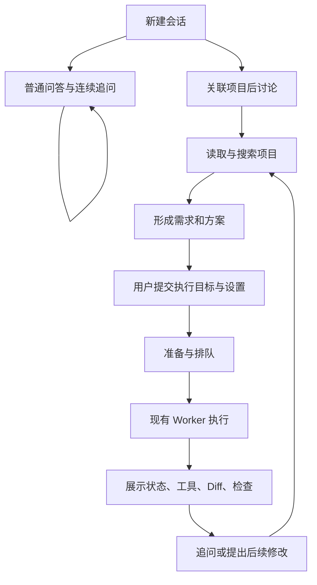

# Chat 核心设计草案

## 2026-11-12 讨论回复流式输出

讨论轮 Provider 使用真实 SSE 文本流；完整聚合工具参数后才沿用既有校验与执行。Worker 将节流、脱敏后的累计文本快照保存为 `model_text` 事件，HTTP `/events?stream=1` 按序号回放并推送，浏览器 EventSource 断线通过 `Last-Event-ID` 续传。部分文本仅作临时显示，完成后由正式消息替换；中断、截断或协议失败不标记回复成功，已经收到部分响应时不自动重放模型请求。编码修改轮当前仍走既有执行结果回传。实现通过静态语法核对；新增离线用例未运行，真实 Provider 兼容性与浏览器端到端效果待验证。

## 2026-11-12 上下文去重与前缀复用

上下文组装版本为 `chat-text-v2`。仅合并连续、权限相同、内容去除首尾空白后相同，且前次明确失败、无回复与工具观察的重试；保留最后一次需求、失败摘要及 manifest 中的原始引用，不修改持久化历史。未知状态、成功回复和已取得的证据不按重试删除。

系统指令固定，当前权限及裁剪数量放在历史之后、本轮问题之前。记录 `stablePrefixSha256`、`stablePrefixMessages` 和独立的工具指纹；工具循环继续尾部追加。指纹用于核对输入稳定性，不代表实际缓存命中。跨轮观察选择、裁剪、工具集合或临近预算时的工具变化仍可能缩短共同前缀；Provider 缓存效果尚待实际 usage 验证。本批仅完成静态核对，未运行回归用例。

日期为 2026-11-11，北京时间。本文保留 A 批设计，并在下方标出 C 阶段最新修订；两者冲突时以修订为准。B1/B2 与 B3 前端实施边界见 [B1 实施记录](b1-status.md)、[B2 实施记录](b2-status.md) 和 [B3 前端记录](b3-frontend-status.md)。总体范围见 [阶段计划](V06-chat-evaluation-plan.md)，评价契约与样本见 [评估设计](evaluation-design.md)。

## 2026-11-11 C 阶段方向修订

用户确认最终形态：Chat 是交互入口，Agent 是统一执行引擎，coding 是可按权限调用的一组能力。以下早期设计中的“讨论处理器 + 执行桥接”仅记录当时的分步设想，不作为 C 阶段最终架构要求；不能把它实现成一个聊天模型指挥另一个编码模型，也不能让对话执行变成独立表单产品。

- 同一个会话持续保存用户与 Agent 的交流。每轮运行从会话构造有边界、可追溯的上下文；需要时调用工具，直接回答时返回文字。当前 `Agent.run(task)` 每次新建上下文、只接收工具决策，`ChatExecution` 只接收文字，这两处需要收敛为同一执行循环，而非仅把页面和接口连接起来。旧任务入口仍可通过兼容适配调用该能力。
- 同一会话的新消息可以在当前轮运行时提交，按提交顺序持久排队；当前轮继续完成，不接收中途插入的需求，也不做可打断式交互。下一轮启动时只纳入截至该轮的会话历史和上一轮已落库的结果，不提前读取更晚排队的消息。这部分已按授权接入代码，尚未运行新测试。
- 每轮保存权限、预算、工具观察和实际结果。无项目时可直接回答；项目讨论可使用已有搜索、读取工具；本轮有明确修改授权时使用已有编辑、准备、Worker、补丁和检查设施。权限由程序在工具调用处核对，不能仅依赖模型说法。
- 用户在同一会话中说“按这个方案改一下”时，若前文目标、范围及执行设置已明确并可复用，就直接提交有权限的运行；缺少关键条件才在对话内澄清或补齐。无需默认重新填写独立任务表单，也不重复索取已有授权。
- 讨论历史进入本轮执行上下文；工具结果与执行摘要带来源回到会话。追问依据实际记录回答。历史文件观察只代表当时版本；再次读取或编辑前核对当前文件，变化时重新取得证据。
- 内部可保留 Conversation、Turn 与既有 Task/Execution 记录，分别承载连续历史和单轮可恢复运行。分步开发先让项目问题能按需读取，再开放授权修改与追问；每次验收围绕“问项目 → 要求修改 → 追问结果”这条完整用户流程检查，不把三个步骤当成三个 Agent 产品。

目前已接入 Chat 轮次的 Agent 文字/只读工具循环、同会话消息排队，以及由 Chat 的明确授权轮次创建并排入既有编码任务。编码任务仍由原 Agent 执行，Chat 不额外调用一个模型指挥它；任务结果及检查事实回写会话供后续追问。本批代码尚未运行测试，不能据此宣布整条流程验收通过。B3 评估记录暂缓。

## 首版用户流程

Chat 页面包括会话列表、消息区、输入区和按需展开的运行详情。会话顶部显示关联工作区，输入区显示当前为讨论或执行，以及本轮权限。工具观察、实际检查和模型说明分别具有明确来源。旧任务详情继续提供完整材料入口。



首版使用整轮文字响应，工具与状态事件按轮询增量显示。每个会话同时接受一个活动轮次，运行中输入内容作为草稿保留。独立会话可在 Worker 容量内推进。以下四条流程是首版必备交付。

| 流程 | 用户操作与服务端行为 | 可见结果 |
| --- | --- | --- |
| 普通问答 | 新建无工作区会话，发送问题，再发送引用上轮内容的追问 | 两轮均持久保存，第二轮输入包含首轮消息；无项目和文件工具依赖 |
| 项目讨论 | 新建关联工作区的会话，询问调用关系；Worker 在只读模式读取和搜索 | 回复包含路径/行范围，工具观察关联实际文件版本，写入权限关闭 |
| 讨论到执行 | 用户在会话内选择执行，提交明确目标和权限设置 | 保存授权快照，生成关联任务，展示真实队列与执行过程，完成后可查补丁和检查 |
| 失败与结果追问 | 运行终止后询问已做什么、为何失败或如何调整；后续修改再次提交执行 | 回答依据保存材料，区分模型结论、程序状态和检查；每次新执行具有独立 ID |

首版会话在创建时绑定零个或一个工作区。工作区配置引用服务端登记信息，消息内容中的路径不改变权限。需要更换工作区时新建会话，可选择携带摘要，摘要保留来源且不携带旧授权。后续执行的实际 worktree 单独显示，用户可选择将该副本作为新会话工作区。

## 权限与执行入口

普通发送默认 discuss。无工作区时允许纯文本问答，有工作区时额外允许 list_files、search_code、read_file。讨论不提供编辑、测试和任意命令工具，工具分发层再次检查权限。

用户选择 execute 后，输入区展示任务目标、预期行为、修改范围、direct/worktree、最大决策数及测试设置。按当前能力，目标和预期说明沿用既有任务字段上限，决策数为 1 到 50，测试默认关闭。普通目录/单文件沿用现有 direct 约束。保存执行设置后，明确的执行提交即构成本轮授权，前端将模式与完整契约一并提交。

模型可在回复中提出执行草案，UI 仅提供填入执行设置的操作。草案不能自行创建活动执行。后端校验 workspace 身份、契约与提交的模式，冻结本轮权限，后续模型输出不能扩大范围。用户新建会话或发送讨论消息时，仍按对应请求的讨论权限处理。

执行目标由用户本轮明确内容和选定讨论结论形成，允许在会话内直接发起第一轮执行。上下文、目标、权限快照均保存，便于核对目标从何而来。

## 对象、持久化与唯一约束

建议新增 PostgreSQL 表，仍由当前后端仓储负责事务。ID 使用 UUID 格式，API 沿用项目 camelCase 命名。

| 表 | 主要字段与约束 |
| --- | --- |
| chat_conversations | conversation_id、namespace、workspace_ref 可空、title、revision、next_message_seq、active_turn_id、时间 |
| chat_messages | message_id、conversation_id、seq、turn_id、role、content、source_refs；UNIQUE(conversation_id, seq)，每轮最多一条最终 assistant 消息 |
| chat_turns | turn_id、conversation_id、client_request_id、request_hash、mode、input_message_id、context_cutoff_seq、policy_snapshot、stage、终态/原因、response_message_id、时间；UNIQUE(conversation_id, client_request_id) |
| chat_turn_jobs | turn_id 主键、namespace、job_kind、status、worker_id、claim_id、心跳与时间；只承载讨论及执行桥接工作 |
| chat_execution_links | turn_id 主键、task_id 唯一、execution_id 可空、bridge_stage、contract_hash、关联时间；任务删除后保留关联标识与材料可用性 |
| chat_turn_events | turn_id、seq、type、payload、时间；UNIQUE(turn_id, seq)，支持增量读取 |

请求摘要覆盖模式、正文、权限和执行设置。先查询幂等键，相同键与摘要返回原 Turn，摘要不同返回 REQUEST_KEY_REUSED。全新请求再检查会话 revision、活动轮和输入边界，事务内创建用户消息、Turn、Job，更新 active_turn_id 与 revision。所有修改按会话行锁串行。

revision 表示会话可见状态的版本，接受新轮和终态落库时更新。客户端获得服务端最新 revision 后提交新轮。幂等重放先于 revision 校验，允许超时重发取得旧请求结果。

模型请求不持有数据库事务。Worker 只在领取、保存观察、完成轮次等短事务中操作数据库。写入须核对 worker_id 和 claim_id，失效领取者的晚到结果单独保留诊断，不能覆盖已核实的终态。

讨论最终回复、response_message_id、轮次终态、终态事件及 active_turn_id 释放在同一事务提交。首版每轮最多一条最终回复，工具结果保存为观察与事件，页面展示由 source_refs 连接原始材料。

ContextManifest 和模型输入材料保存在 runs/chat/<conversation-id>/<turn-id>/，数据库保存材料引用与哈希。目录按现有忽略约定处理。数据库负责消息、调度与索引，文件负责详细输入、轨迹和附件，两者的保存范围明确记录。

## 状态与故障恢复

讨论状态按 queued → running → completed 或 failed 变化。领取丢失或响应落库结果不明时显示 unknown。执行轮额外有 preparing 阶段，准备完成后由关联任务的调度与结果派生 queued、running、finalizing 和终态。

| 情况 | 处理与恢复 |
| --- | --- |
| POST 响应丢失 | 客户端使用原 clientRequestId 重发，返回原轮次和最新状态 |
| 多标签页提交 | 同一会话行锁与活动轮校验，只接受一轮；409 返回最新 revision 和活动轮 ID，保留未发送草稿 |
| API 重启 | PostgreSQL 中消息和待领 Job 保留，浏览器重新 GET 恢复 |
| Provider 明确失败 | 保存错误分类、已有观察及用量覆盖情况，结束为 failed，允许新轮追问 |
| 上下文超限 | 在请求模型前保存 CONTEXT_LIMIT 和已用范围，提示缩小选择；不发送截断后残缺工具消息 |
| Worker 心跳丢失 | 显示 unknown，保留活动关联，不依据心跳单独重放模型或业务操作 |
| 已确认旧 Worker 退出 | 核实持久结果与文件材料，能恢复已保存终态则补齐投影；其余以失败/待核实结束记录，释放会话交互并保留未核实文件副作用提示 |
| 执行结果缺失 | 保留 taskId、executionId 和 diagnostics 入口，回答仅使用已有证据 |
| 关联任务被移入回收站/清理 | 消息保留历史说明，显示材料已不可用或已删除，禁止凭旧链接宣称当前文件状态 |

执行 unknown 时允许在确认旧 Worker 退出后继续讨论，后续写入遵循既有任务 recovery 对目标工作区的限制。首版新增轮次不会隐式续跑未知执行。恢复记录需包含核实来源和时间，原故障事件保留。

会话终态 completed 表示本轮交付已形成。执行 outcome、stopReason、检查和评分作为单独字段展示。预算耗尽可形成完整的未完成交付，程序/材料失败则为 failed 或 unknown。

## Worker 与现有执行衔接

同一 Worker 进程继续维护一个共享容量的线程池。领取调度在 chat_turn_jobs 与原 task_dispatch 间交替尝试，某类无可领取项时使用另一类，每次领取仍遵守原任务冲突规则和命名空间。讨论 Job 直接完成文本/只读工具循环，执行桥接 Job 只负责创建、准备和入队，入队后释放槽位。

执行桥接按以下可恢复步骤推进。

1. 锁定 Turn，保存预分配 task_id、执行契约及 bridge_stage。重复领取只处理同一关联。
2. 调用既有规范化/校验逻辑，按预分配 ID 幂等创建普通任务与元数据。需要为现有创建逻辑增加内部事务入口，保持旧 API 行为。DB 外材料生成沿用现有可恢复物化机制。
3. 调用 TaskPreparation，已有准备结果按身份核对。准备中断沿用其错误记录，保留部分副本，按原恢复边界处理。
4. 调用 QueuedExecution.start，对同一 task_id 幂等入队，将 execution_id 保存到关联；若入队成功而关联落库失败，从 task_dispatch 恢复同一 ID。
5. 释放桥接 Job。关联执行的状态读取与轮询、Worker 完成回调和启动核对共用一份 reconcile 逻辑，按原始任务状态补齐会话投影和最终交付，唯一约束阻止重复回复。

恢复桥接前必须确认原 Job 的领取所有者已退出。文件副本准备无法确认身份时保留失败记录，避免另建副本覆盖原材料。执行中的任务由原任务调度持有，不同时持有 chat Job 线程。

项目读取沿用 RepoTools 的路径、安全文件类型和版本校验，抽出必要的只读策略供讨论调用。多个读取可能遇到文件变化，每条观察记录自己的哈希；整轮回复保留观察到的版本边界。现有仓库锁覆盖内部部分写操作，外部编辑仍通过版本校验识别。

## 上下文与 Provider

每轮 ContextManifest 保存组装版本、消息截止 seq、选中消息、引用观察、文件版本、权限摘要、关联运行、实际调用输入与工具定义哈希。权限以服务端快照为准，仓库文件和历史工具输出作为资料输入。

讨论上下文包含系统规则、已完成的用户/assistant 对话、明确的失败状态、当前用户问题和本轮工具历史。上一轮工具原始输出按引用选取，调用/结果保持完整配对。执行上下文包含明确目标、选定需求结论、权限及现有执行状态，具体文件在该轮重新读取。

每次模型调用保存真实发送输入与工具定义的脱敏材料、指纹及长度。默认首版不做自动摘要。用户消息上限 8000 字符。2026-11-12 根据真实运行修订：讨论轮取消固定 8 次决策上限，分别检查单次请求的模型 token 预算、整轮累计估算 token 和耗时；临近预算时停止提供工具并要求根据已取得的观察回答。兼容 Provider 的聊天模板和实际用量可能与本地估算不同，记录估算与实际用量，字节上限仅用于传输安全。工具结果加入后再次核对预算，无法容纳必要输入时保留观察并形成明确失败。

Provider 建议新增 respond(messages, tools, response_limits)，返回 TextReply 或 ToolCallReply，并复用 HTTP、重试、脱敏与用量。编码 decide() 继续维持既有 Decision 协议。讨论接受自然语言作为最终回复，若同一响应含工具调用和文字，文字作为中间说明，完成全部合法工具调用后才允许结束。

讨论一次只接受一个工具调用，参数/名称校验后执行。越权或格式错误反馈进入预算，耗尽则保存失败。纯文字无有效内容、Provider length 截断及不支持的多工具批次均有明确错误。Provider 请求次数、重试次数和模型决策数分别记录，失败尝试也计入请求与用量完整性。

## HTTP 建议契约

沿用现有来源检查、错误外壳和分页参数校验。以下示例中的标识均为占位值，真实服务使用规范 ID。

| 方法与路径 | 行为 |
| --- | --- |
| POST /api/conversations | 创建会话，接受 title 和可选 workspaceRef，返回 201 |
| GET /api/conversations?cursor=&limit= | 会话列表，按更新时间和 ID 稳定排序 |
| GET /api/conversations/{id} | 返回 revision、工作区与活动 Turn |
| GET /api/conversations/{id}/messages?afterSeq=0&limit=50 | 增量消息，返回 nextAfterSeq 和 hasMore |
| POST /api/conversations/{id}/turns | 持久提交一轮，新请求返回 202，幂等重放返回 200 |
| GET /api/conversations/{id}/turns/{turnId} | 返回本轮状态、权限、响应引用、可选关联执行和材料可用性 |
| GET /api/conversations/{id}/turns/{turnId}/events?after=0&limit=50 | 轮次事件游标和必要的既有执行事件引用 |

提交讨论的示例载荷如下。

```json
{
  "schemaVersion": 1,
  "clientRequestId": "request-id",
  "expectedRevision": 0,
  "mode": "discuss",
  "content": "请解释这个模块的调用关系"
}
```

执行提交增加 execution 字段，工作区从会话解析，Git baseCommit 由服务端创建任务时解析并固定，准备阶段核对并使用该版本。用户选择的需求结论必须在会话截止点以内。

```json
{
  "schemaVersion": 1,
  "clientRequestId": "new-request-id",
  "expectedRevision": 2,
  "mode": "execute",
  "content": "按刚才确定的方案修改解析逻辑",
  "execution": {
    "kind": "add_feature",
    "expected": "空输入返回空列表，保留已有正常输入行为",
    "workspaceMode": "direct",
    "revision": "HEAD",
    "allowedPaths": ["src/parser.py"],
    "allowTests": false,
    "checkTargets": [],
    "maxSteps": 30,
    "contextMessageIds": ["selected-message-id"]
  }
}
```

返回包括 turnId、inputMessageId、conversationRevision、status、eventsUrl，关联执行建立后另含 taskId 与 executionId。工作区未绑定的 execute 返回 WORKSPACE_REQUIRED。其他主要错误包括 REVISION_CONFLICT、TURN_ACTIVE、REQUEST_KEY_REUSED、INVALID_SCOPE、CONTEXT_LIMIT 和 MODEL_PROTOCOL_ERROR。禁止跨 conversationId 读取另一个会话的 Turn/观察。

会话消息和轮次事件各有游标。执行工具事件通过 taskId/executionId/seq 引用原事件，避免复制完整输出和产生两套序号事实。页面按关联加载旧执行接口，失败响应展示真实状态并保留用户草稿。

## 实施拆分与设计验收

B1 先实现新增表、事务仓储、幂等提交和文本 Provider 接口；B2 接讨论 Job 与共享 Worker 容量；B3 接会话 UI、上下文材料和 EvalRun 索引。C1 接项目只读工具，C2 接执行桥接与状态投影，C3 接结果追问和后续执行。

预期主要修改范围为 backend/schemas、repositories、services、routers、app/worker 组装、core/provider/context 及 frontend。新增 Chat 服务与现有 TaskService 通过明确接口协作，保持现有标准库 HTTP 和任务入口。

A 批设计核对覆盖四条用户路径、唯一约束、双队列容量、桥接部分失败、旧 Worker 晚到结果、文件变化、跨会话读取、任务材料清理及用量缺失。上述为桌面推演，尚未形成实现或运行验证。实现后按用户指定范围再运行对应工程验收与评估。
